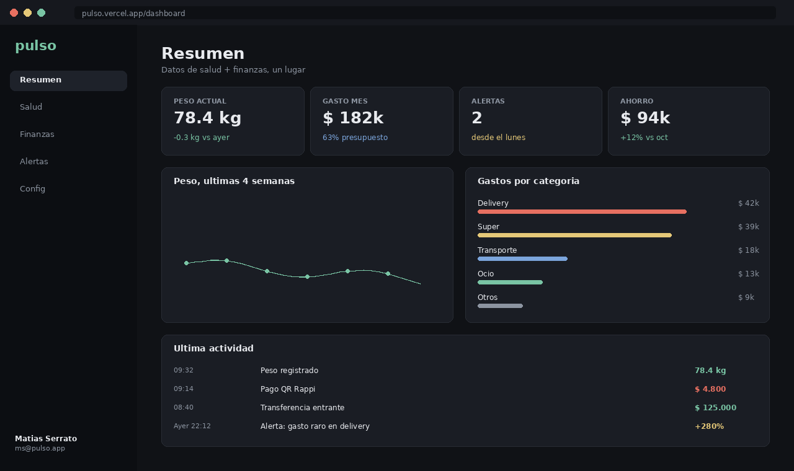
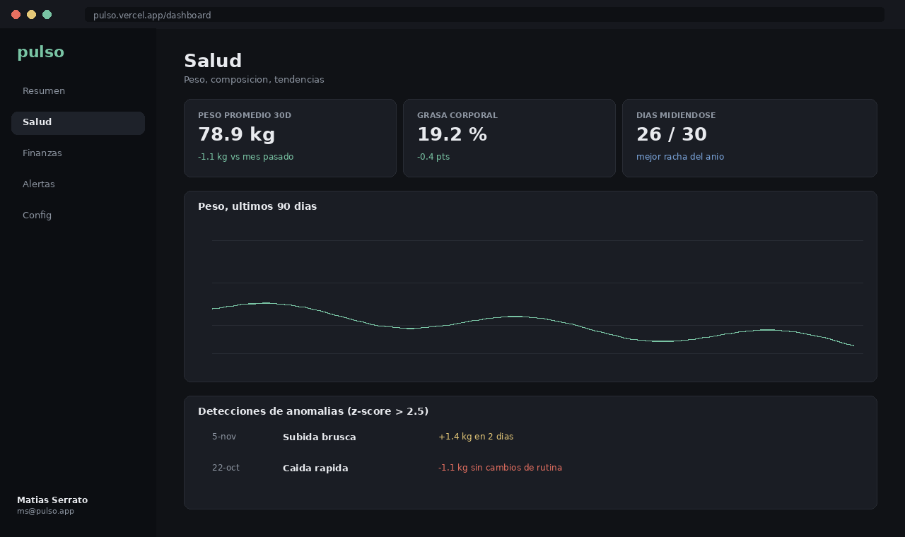
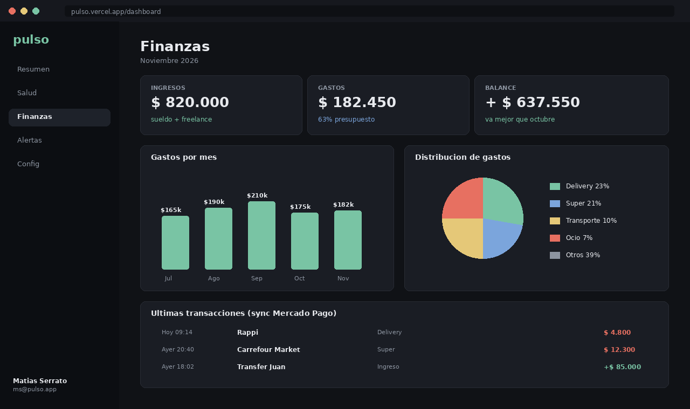

# pulso-web

El frontend web de Pulso. Dashboard para ver el peso, los gastos y las anomalias que el backend detecta, con graficos lindos.

Parte del proyecto Pulso: [pulso-api](https://github.com/MatiasHernanSerrato/pulso-api) (Go + GraphQL) y [pulso-mobile](https://github.com/MatiasHernanSerrato/pulso-mobile) (Flutter).

## Pantallas

<p align="center">
  
</p>

<p align="center">
  
  
</p>

El layout es responsive pero el dashboard real brilla desde 1024 px para arriba, que es donde agregamos la sidebar fija y los graficos crecen al ancho que necesitan. En mobile se vuelve una columna con las cards apiladas.

## Stack

- Next.js 15 con App Router y Server Components
- React 19
- Tailwind v4 (sin config, todo en css)
- TypeScript

Estoy probando el motor nuevo de Tailwind v4. Tiene algunos bugs todavia pero el DX me cierra.

## Correrlo

Hace falta Node 20+. Despues:

```bash
npm install
npm run dev
```

Abre en http://localhost:3000.

## Env

Copia `.env.example` a `.env.local` y cambia lo que haga falta. Por ahora solo esta la URL del GraphQL del backend.

## Deploy

Esta configurado para Vercel. En el dashboard del proyecto hay que setear:

- `NEXT_PUBLIC_API_URL`: URL del GraphQL del backend (public, va al bundle). En prod, `https://pulso-api.fly.dev/graphql`.
- `API_URL`: misma URL pero sin `/graphql` al final, para los rewrites de server. En prod, `https://pulso-api.fly.dev`.

El `vercel.json` ya tiene los headers de seguridad basicos y el region fijado en gru1 (Sao Paulo) para quedar cerca del backend en fly.

### Healthchecks

- `/healthz` devuelve `{status, service, commit, region}` sin pegarle a la api. Me sirve para los uptime checks y para que Vercel pueda monitorearlo.
- `/status` es un alias por rewrite, por si alguien busca el path ese.

### SEO

Los preview deploys (`VERCEL_ENV !== "production"`) devuelven `X-Robots-Tag: noindex` via `app/robots.ts` y el metadata del layout, asi no terminan rankeando antes que la prod. El sitemap solo se publica cuando `VERCEL_ENV === "production"`.
